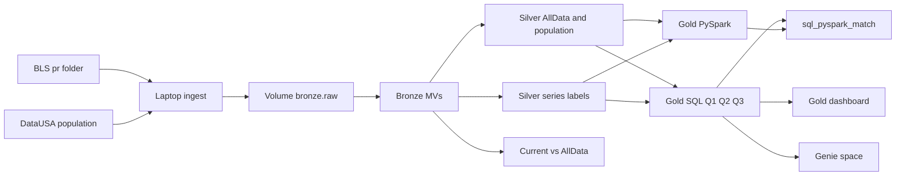

# Process

I read the assignment first, then the BLS pr listing, pr.txt, the BLS data-access policy, and the population API. After that I used Cursor in plan mode, and I approved the plan before writing project code.

How to run this in a workspace is in `RUNBOOK.md`. Screenshots of the pipeline, catalog, gold answers, job run, dashboard, Genie, and gold grants are in `docs/screenshots/`.

## Done

- Installed the Databricks CLI and logged in with profile `data-quest`.
- Wrote a local ingest script. It landed the BLS folder and the population JSON in `pr_population.bronze.raw`. A rerun with the same hashes uploaded nothing.
- Built bronze as materialized views over the volume. Counts: AllData 92,328, Current 46,159, series 337, population 11.
- Built silver in Python. Snapshot CDC (SCD type 1) keeps current AllData and population. `pr_series_label` joins the latest bronze series and code files. Current is a subset check, not a silver table.
- Built gold. SQL is the primary answer. PySpark sits beside it. `sql_pyspark_match` was true for all three questions.
- Deployed the pipeline with a Declarative Automation Bundle, plus job `pr_population_refresh` as the workspace trigger. No schedule. Ingest stays on the laptop.
- Built an AI/BI dashboard on the gold SQL tables, and a Genie space on the same three tables so a stakeholder can ask the questions in English.
- Granted `account users` `USE CATALOG` and `BROWSE` on `pr_population`, plus `USE SCHEMA` and `SELECT` on `gold` only. Bronze and silver stay ungranted.

**Gold answers from the successful run:**

- Q1: mean 322,069,808, sample stdev 4,158,441.04, population stdev 3,796,119.94, 6 years
- Q2: 337 series
- Q3: 39 years of `PRS30006032` Q01

Screenshots:

- Pipeline: [graph](docs/screenshots/01-pipeline-graph.jpg)
- Catalog: [gold](docs/screenshots/02-catalog-gold.png), [silver](docs/screenshots/03-catalog-silver.png), [bronze](docs/screenshots/04-catalog-bronze.png)
- Q1: [table](docs/screenshots/05-q1-population-2013-2018.png), [Genie](docs/screenshots/10-genie-q1.png)
- Q2: [table](docs/screenshots/06-q2-series-best-year.png)
- Q3: [table](docs/screenshots/07-q3-prs30006032-q01.png)
- Job: [full refresh](docs/screenshots/08-job-full-refresh.jpg)
- All three on the dashboard: [dashboard](docs/screenshots/09-dashboard-gold.png)
- Grants: [gold](docs/screenshots/12-grants-gold.png), [bronze](docs/screenshots/11-grants-bronze.png)

## Architecture

- Two sources. BLS is productivity (PR). The API is Census ACS population. Q1 is population only, Q2 is BLS only, Q3 joins them on year.
- Catalog `pr_population`, schemas `bronze` / `silver` / `gold`. Table names do not repeat the layer. Source files follow the same split: `src/pipeline/bronze/`, `src/pipeline/silver/`, `src/pipeline/gold/`.
- Free Edition serverless outbound internet is limited, so ingest runs on the laptop and uploads to volume `pr_population.bronze.raw`. A new dated snapshot is written only when sha256 changes.
- Bronze is a batch materialized view of those files. The extract is small, so a full refresh of bronze is enough.
- Silver current for AllData and population is AUTO CDC FROM SNAPSHOT (SCD type 1), from a pipeline view of the latest bronze snapshot. Labels are one join off the latest bronze series and code files. Current is only checked against AllData.
- Gold recomputes from silver current. SQL is primary because the answers are aggregates a teammate should read as SQL. PySpark is the other implementation the brief asked for. `sql_pyspark_match` fails the update if they disagree.
- The dashboard and Genie space read gold SQL only. Dashboard queries run as the viewer, so Unity Catalog still decides what they see. Genie is created from `src/genie/gold.geniespace.json`. It is not a bundle resource. Bundle Genie needs the direct deployment engine, and I did not change how the pipeline deploys.
- AllData is the fact source. Best year sums Q01 to Q04, uses Q05 only when a series has no quarters, and takes the latest year on a tie. Q3 keeps years with no population. Q1 stores sample and population standard deviation. Sample is the reported answer.

## Trade-offs

- Bronze still reads every `snapshot_date` folder. A second real source change will duplicate keys there. Silver CDC is what keeps one current row. Before this went to a client I would stop bronze from unioning old snapshots.
- I would add a cron that runs ingest and starts the pipeline only when something uploaded. Auto Loader would not do that. It only sees new files while an update is already running. The workspace cannot run ingest on Free Edition.
- Unknown BLS files stay in the volume. I did not invent a table for them.
- A client with open egress could run the same ingest script inside the workspace. I kept it on the local because this workspace is likely to block download.bls.gov and datausa.io.
- I skipped CI/CD. The remaining bonus items were the gold dashboard or Genie space, and the read-only gold grants.
- The Genie space is under `/Shared`, so workspace users inherit `CAN_MANAGE` from that folder. A client would put it in a folder with `CAN_RUN` only.

## Issues

- BLS returned 403 until `User-Agent` included a contact. Email is `BLS_CONTACT_EMAIL`.
- Changing the pipeline catalog in YAML did not recreate it. Databricks refused to move tables across catalogs. I deleted the old pipeline and deployed a new one on `pr_population`.
- Population `data` came in as an array on batch json. First bronze run wrote 0 population rows because `from_json` was applied to that array. `from_json` is only used if the column is a string.
- `create_auto_cdc_from_snapshot_flow(..., name=...)` failed on this runtime. The call is still `apply_changes_from_snapshot()`, which does not take `name`. A Python `next_snapshot` function also cannot read another table in the same pipeline. CDC `source` is a pipeline view of the latest bronze snapshot.

## AI usage

I used Cursor in plan mode to read the brief, the BLS files, the population payload, and Free Edition limits, then to pair-program ingest, bronze, silver, and gold. I also used it to draft `PROCESS.md` and `RUNBOOK.md`, and to review the changes and the end-to-end implementation. I did not take the generated code or docs as done. I ran the CLI and warehouse SQL myself, and I kept only what those runs actually showed.

## Retrospective

The BLS 403 was the first thing that was actually hard. The folder listing loaded fine, then every file download failed until the User-Agent had a contact, which is what their data-access policy asks for.

The Current-vs-AllData gate was the other one. `expect_or_fail` on the check table only fails that flow in a triggered pipeline. The other silver tables can still land. I put `assert_true` on the CDC snapshot views so AllData and population do not apply a snapshot when Current is not a subset of AllData, and labels write zero rows in that case.
